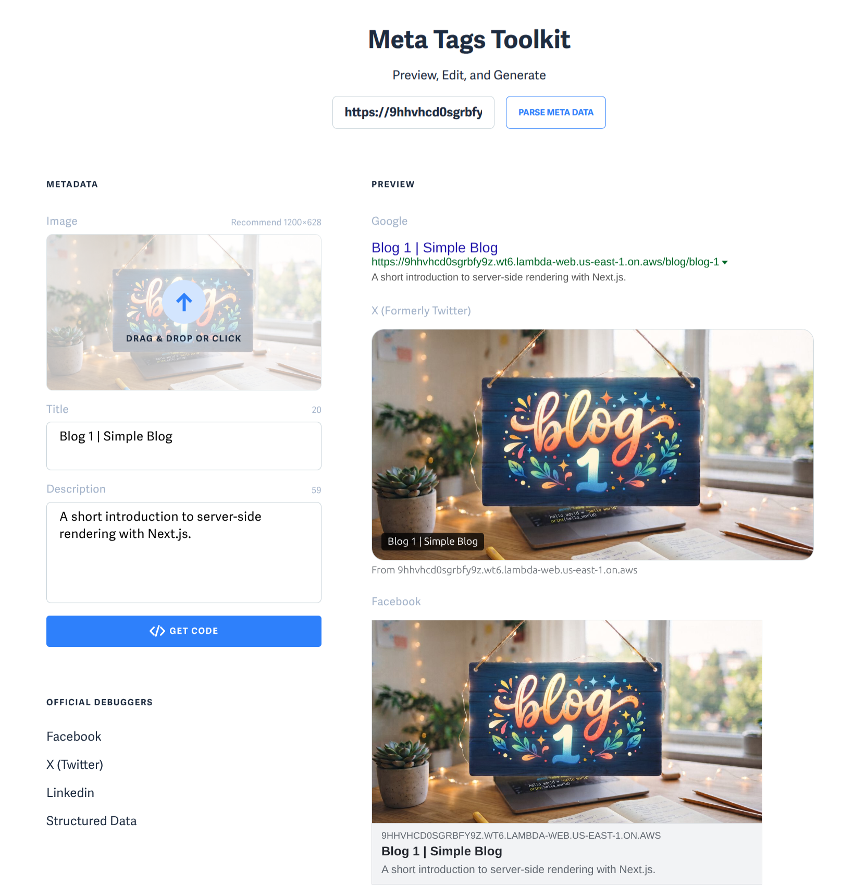

I wanted to see how little infrastructure a small Next.js website could get away with. The result is a three-page blog running on AWS Lambda: a home page and two posts generated from Markdown, with server-side rendering and working social previews. In the past doing this meant lot of manual configuration, lot of hacking and yet subpar developer experience. Which has been the main selling point of many SAAS providers like Vercel which made the development of SSR powered apps a dream.

Not today! We got something new of AWS.

## Web function runtime

[AWS Lambda Web Functions](https://aws.amazon.com/blogs/aws/announcing-aws-lambda-web-functions-for-fast-consistent-web-app-performance-anywhere/) let you run a standard HTTP server on Lambda. Your application listens on a port and handles normal web requests; Lambda manages the execution environments and scaling. The magic of serverless is in your hands. This means, you can have Vercel like app developer experience with all the goodies from AWS like DynamoDB, S3, and many more.

That makes frameworks such as Next.js a natural fit. The [official runtime documentation](https://docs.aws.amazon.com/lambda/latest/dg/web-functions-runtimes.html) explains the Node.js runtime and the `AWS_LAMBDA_HTTP_ENDPOINT` variable that tells your server where to listen. In this demo, a tiny startup file maps that address to Next.js's `HOSTNAME` and `PORT` variables before starting its standalone server.

## Why this is useful

- 🎯 **Less boilerplate and vendor-specific application code.** Keep normal HTTP routes and framework conventions, with fewer Lambda-specific pieces in the application.
- 🎯 **Simpler migration of standard web apps.** An existing Node.js web server is much closer to the deployment target, reducing the work needed to move it to Lambda.
- 🎯 **A good fit for nearly stateless applications.** Keep durable data and sessions outside the process so requests can reach any environment. This can reduce bugs caused by relying on local state, although Web Functions do not make an application stateless automatically.
- 🎯 **Scaling without managing EC2 instances or an Elastic Load Balancer.** Lambda manages the compute behind the endpoint, giving a small website fewer moving parts to operate.
- 🎯 **Inexpensive hosting for SSR apps.** Next.js can render pages on Lambda with usage-based billing—potentially pennies for a tiny workload. Costs still depend on requests, active CPU time, memory, and data transfer; this demo is not a monthly cost benchmark. See the [Web Functions pricing overview](https://aws.amazon.com/lambda/lambda-web-functions/).

## Server-rendered pages and metadata

The application is deliberately plain: three images, two Markdown files, a shared blog route, and minimal CSS. You can find these files in my github [here](https://github.com/anuradhawick/web_function_runtime/tree/main/app/content).

In the home page's `page.tsx`, rendering waits for a request before reading the posts and creating a timestamp:

```tsx
await connection();
const posts = await getPosts();
const renderedAt = new Date().toISOString();
```

Refreshing the page changes that server timestamp. The article content is returned as HTML, rather than fetched into an empty page by browser JavaScript.

The same file exports Next.js metadata. Here is its Open Graph section:

```tsx
openGraph: {
  type: "website",
  title: "Home | Simple Blog",
  description: "A simple blog about server-side rendering and SEO.",
  url: "/",
  images: [{ url: "/hello%20world.jpeg", width: 1200, height: 655, alt: "Hello world" }],
},
```

Its Twitter metadata selects a large image preview:

```tsx
twitter: {
  card: "summary_large_image",
  title: "Home | Simple Blog",
  description: "A simple blog about server-side rendering and SEO.",
  images: ["/hello%20world.jpeg"],
},
```

Next.js turns these server-side metadata exports into tags such as `og:image` and `twitter:image`. The layout supplies `metadataBase`, so image paths become absolute URLs that preview crawlers can fetch.

For the posts, `app/blog/[slug]/page.tsx` uses `generateMetadata()` to read each Markdown file's title, description, and image. One route produces distinct content and metadata for Blog 1 and Blog 2. The images are resized to 1200 × 655 and compressed to roughly 100 KB each.

## Checking the result

I checked the deployed blog with [Meta Tags](https://metatags.io/). The screenshot shows Blog 1's title, description, and image appearing in the social previews:



The useful check is that a crawler can retrieve the page metadata and fetch the preview image. SSR and metadata give readers and crawlers usable content; they do not guarantee search rankings.

## Troubleshoorting and Tips

As of this writing, there was not official release on the terraform aws module. However, I was able to luckily find the commit tag which implemented the provider resource [here](https://github.com/hashicorp/terraform-provider-aws/pull/50727) from just few days ago. So it won't be long until the actual provider release comes with the feature in. So the boilerplate you might see in the repo is just noise from my (and my AI) compiling the provider and using that.

In the coming days-weeks, I will keep and eye out and update the blog and repo so it is very clear without all the noise. I expect the DX (developer experience) with the properly polished terraform provider would be much better (hopefully it does the setting of all the env variables too).

## Try it yourself

The [demo repository is on GitHub](https://github.com/anuradhawick/web_function_runtime). It contains the Next.js app, the Markdown posts, and Terraform for the Lambda Web Function, revision, and endpoint. Follow the README to run it locally or deploy your own copy.
